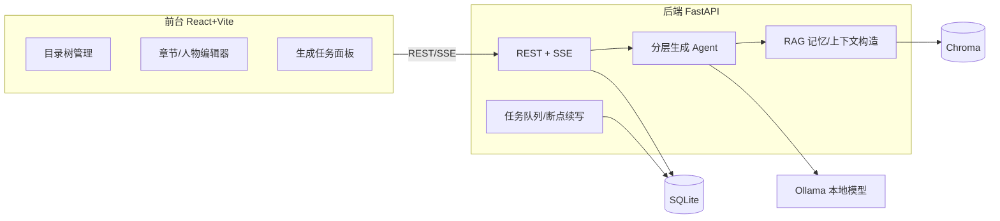
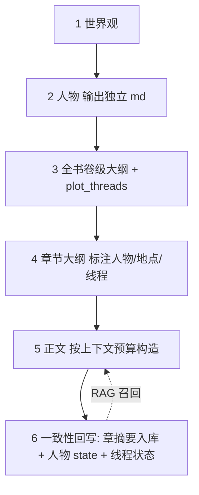

# AI 长篇小说生成平台

从零构建,目标支持十万至百万级字数。核心不是单次对话生成,而是"分层大纲 + 结构化记忆 + RAG 检索 + 多级摘要压缩"的工程系统,Ollama 只作执行器。

## 技术栈(已确认)

- 前台:React + Vite + pnpm + TypeScript,Ant Design,`@uiw/react-md-editor`,目录树虚拟滚动
- 后端:Python + FastAPI + SQLAlchemy
- 存储:SQLite(结构化) + Chroma(向量)
- 模型:Ollama 本地(正文模型 + `nomic-embed-text` 嵌入),经适配层可切云端 OpenAI 兼容 API
- 通信:CRUD 用 REST,生成过程用 SSE 流式;长任务用任务表 + 断点续写

## 架构

## 分层生成流程

## 数据模型(正文与元数据分离)

- `books` / `volumes` / `chapters`(不含正文) / `chapter_content`(正文单独表,懒加载)
- `chapter_summaries`(给 RAG) / `characters`(md_content + state_json) / `worldbuilding`
- `plot_threads`(伏笔状态机) / `generation_tasks`(checkpoint 断点续写) / `embeddings`
- 目录接口分页且不含正文,按上千章设计,禁止全量加载

## 正文上下文构造(百万字关键)

生成前算 token 预算:本章大纲 + 相关人物卡 + 向量召回世界观 + 前情章摘要(超预算降级为卷摘要) + 向量召回相关片段 + 相关 plot_thread。

## 实施顺序

先打通"世界观→人物→大纲→单章"闭环,再补 RAG 记忆与全书批量/断点续写。前后端分目录:`frontend/` 与 `backend/`。